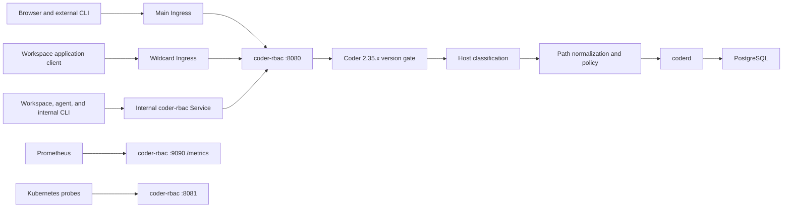
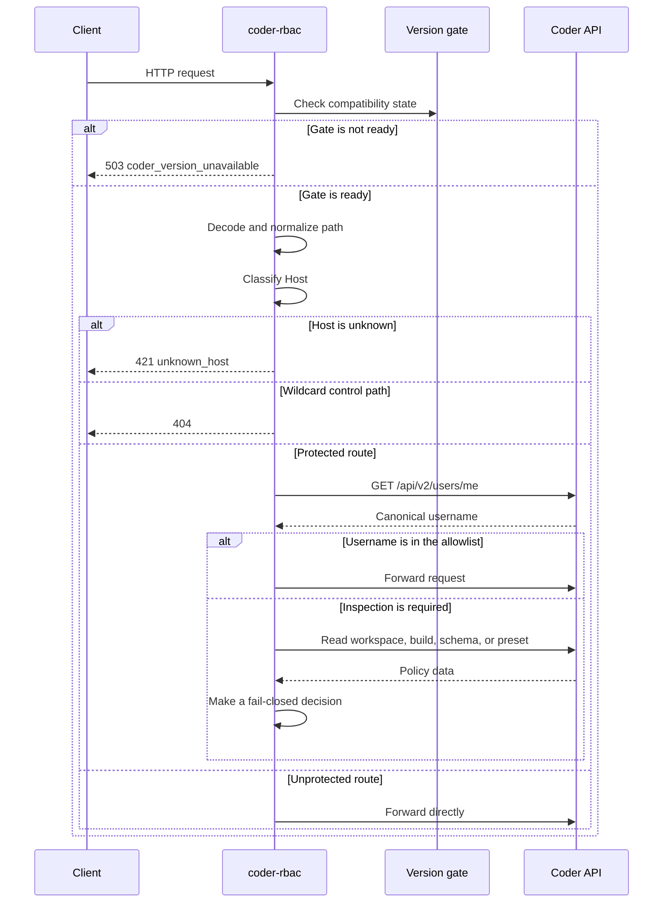
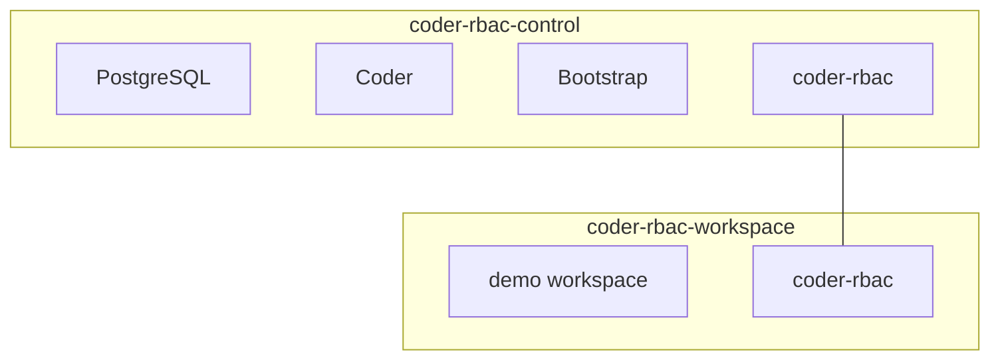

# Architecture

## Purpose

`coder-rbac` is a transparent HTTP reverse proxy between clients and `coderd`.
It preserves Coder authentication while denying selected workspace-management
operations for users who are not in the configured username allowlist.

The process exposes three independent listeners:

| Listener | Default | Purpose |
| --- | --- | --- |
| Proxy | `:8080` | UI, API, CLI, agents, WebSockets, DERP, and wildcard applications |
| Health | `:8081` | `GET /healthz` and `GET /readyz` |
| Prometheus | `:9090` | `GET /metrics` only |

All three listeners must use different ports.

## System overview



## Access paths

### Main public URL

The main Ingress sends the URL configured by `CODER_RBAC_PUBLIC_URL` to the
`coder-rbac` Service. Protected routes pass through policy evaluation. Other
routes are forwarded without an additional `/api/v2/users/me` request.

### Application wildcard

The wildcard Ingress targets the same Service. The proxy preserves the original
`Host` header so Coder can resolve the application and workspace represented by
the subdomain.

The following paths are hidden on wildcard hosts before they reach Coder:

- `/api/v2` and its descendants;
- `/cli-auth` and its descendants;
- `/setup` and its descendants.

They receive `404 Not Found`. Other paths are forwarded to Coder.

### Workspaces and internal CLI traffic

Every workspace must receive:

```text
CODER_URL=http://coder-rbac.<namespace>.svc.cluster.local:8080
```

Workspace pods must not be able to reach the `coderd` Service directly. The
Helm chart provides baseline NetworkPolicies, but their selectors must match the
labels used by the actual Coder deployment and workspace templates.

## Request processing



The processing order is:

1. check version-gate readiness;
2. repeatedly decode and normalize the path;
3. classify `Host` as `main`, `internal`, `wildcard`, or `unknown`;
4. hide control-plane paths on wildcard hosts;
5. classify the method and route on main and internal hosts;
6. identify the user only for a protected route;
7. apply the allowlisted-username exemption, when present;
8. inspect JSON and load additional Coder data when required;
9. forward the request through `httputil.ReverseProxy`.

## HTTP reverse proxy

The proxy uses Go's `Rewrite` API:

- the destination becomes `CODER_RBAC_UPSTREAM_URL`;
- the incoming `Host` is preserved;
- `X-Forwarded-For`, `X-Forwarded-Host`, and `X-Forwarded-Proto` are rebuilt;
- immediate flushing supports streaming responses;
- HTTP upgrades used by WebSockets are relayed;
- transport errors become JSON `502 upstream_unavailable` responses.

## Version gate

At startup, the proxy requests `/api/v2/buildinfo`. The reported version must
start with `CODER_RBAC_EXPECTED_VERSION_PREFIX`, such as `v2.35.`.

- An initial check failure prevents the servers from starting.
- The version is checked again at the configured interval.
- A network error or incompatible version makes readiness fail.
- While the gate is not ready, the proxy listener returns `503` for every
  request.
- `/healthz` remains available to distinguish a live process from a ready proxy.

## Authentication

The proxy has no user database. For a protected route, it calls
`/api/v2/users/me` and forwards only these authentication headers:

- `Authorization`;
- `Coder-Session-Token`;
- `Cookie`.

Coder `401` and `403` responses become an authentication-required rejection.
Any other identity lookup error fails closed with `503`.

Username matching is exact and case-sensitive against the canonical `username`
returned by Coder. The same configuration is portable across Coder instances
only when that username maps to the intended account on every instance.

## Network boundaries

### Docker Compose

The local lab uses separate control and workspace networks:



The workspace cannot resolve the `coder` service. Only `coder-rbac` is attached
to both networks.

### Kubernetes

Kubernetes isolation requires two complementary directions:

- workspace egress permits cluster DNS and the `coder-rbac` proxy port;
- `coderd` ingress permits `coder-rbac` and explicitly required components.

NetworkPolicies are additive. Another permissive policy can invalidate the
intended boundary.
