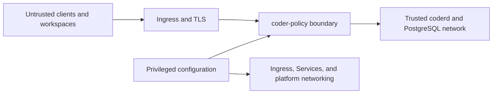

# Security

## Security property

The product is intended to deny Coder access to authenticated usernames outside
the configured administrator and allowed lists, and to prevent admitted
non-administrators from performing selected workspace mutations, including
through the Coder CLI inside their workspace container.

This property depends on all of the following controls:

1. the proxy's HTTP authorization policy;
2. network enforcement that prevents direct access to `coderd`;
3. compatibility with the deployed Coder version;
4. controlled administrator, allowed-user, and Kubernetes configuration.

## Threat model

### Untrusted actors

- a user authenticated by Coder;
- a process running in a workspace;
- compromised template code or a workspace application;
- a client that forges methods, encoded paths, headers, and JSON bodies.

### Trusted components

- the `coder-policy` binary and image;
- `coderd` and its database;
- the Ingress controller and TLS termination;
- administrators who can change Helm values, Secrets, platform networking, and
  templates;
- provisioners and operators explicitly allowed to reach Coder.

### Addressed threats

- direct protected-route calls from the UI or CLI;
- use of a valid Coder cookie or token from a workspace;
- use of a valid Coder user session whose username is not admitted;
- password, username, display-name, or avatar changes by an allowed standard user;
- repeated encoding and ambiguous path segments;
- changes to established persistent or ephemeral parameter values during a
  start or upgrade;
- addition or removal of a persistent parameter in a target template version;
- access to the main API through an application wildcard subdomain;
- a future, unknown build transition;
- detectable Coder API compatibility drift.

### Out-of-scope threats

- compromise of `coderd`, PostgreSQL, or the cluster;
- a malicious Kubernetes administrator;
- an administrator whose canonical username is configured for exemption;
- an unclassified Coder route that provides an equivalent mutation;
- direct `coderd` access enabled by another network exposure;
- security of workspace content and applications themselves.

## Trust boundaries



The proxy is not an effective boundary if untrusted clients have another path
to the trusted network.

## Fail-closed behavior

The proxy rejects access or a protected operation instead of forwarding it when:

- the version gate is not ready;
- `/api/v2/users/me` fails for a reason other than Coder `401` or `403`;
- an identified username is absent from both access lists;
- the workspace or latest build cannot be read;
- the current or target parameter schema is unavailable;
- current values or presets cannot be loaded;
- a submitted parameter requires a current value that is unavailable;
- a Coder policy response is malformed, contains extra JSON, or exceeds 4 MiB.

Every request outside the narrow native-authentication and public-asset set
performs the identity lookup. Coder `401` or `403` identity responses are
forwarded for native anonymous, agent, and service handling. Other identity
failures are fail closed, and every request remains blocked while the global
version gate is not ready.

See [Authorization policy](policy.md#workspace-parameters) for the narrowly
allowed first value of an ephemeral parameter introduced by a target version.

## Authentication and headers

Coder remains responsible for authentication. Auxiliary API calls copy only
`Authorization`, `Coder-Session-Token`, and `Cookie`.

The themed denial page does not clear cookies itself. Its **Change account**
form submits a five-minute signed token to the main public host. The proxy
rejects missing, expired, or invalid tokens before contacting Coder. For a valid
form, it copies the HttpOnly Coder session cookie into the matching
`Coder-Session-Token` header, invokes Coder's native logout endpoint, preserves
Coder's cookie deletion, and redirects only after session and application-token
revocation succeeds. This matching cookie/header mechanism is the native Coder
CSRF exemption for server-originated header authentication.

`CODER_POLICY_LOGOUT_CSRF_SECRET` signs the form token. Helm requires a
high-entropy `config.logoutCSRFSecret` for multiple replicas and stores it in the
release Secret. Direct multi-replica deployments must provide the same value to
every replica; using independent process-local defaults causes valid forms to
fail when requests cross replicas.

The reverse proxy rebuilds `X-Forwarded-*` headers through Go's
`ProxyRequest.SetXForwarded`. It preserves the original `Host` for wildcard
routing. The Ingress must not use attacker-controlled headers to choose a route
that bypasses the proxy.

## TLS

In production:

- use HTTPS for the main and wildcard URLs;
- restrict cleartext traffic to a controlled internal network;
- protect certificates and automate renewal;
- test TLS through a real application subdomain;
- enable the relevant security controls on the Ingress controller.

The Compose lab uses HTTP and disables secure cookies only for local validation.

## Network isolation

### Forbidden exposures

- a direct Ingress to the Coder Service;
- a Coder `LoadBalancer` or `NodePort` Service reachable by users;
- a permanent port-forward distributed as an access method;
- unrestricted workspace egress to the Coder namespace;
- alternate DNS that resolves to a direct Coder endpoint.

### Required evidence

Run these checks from a real workspace:

```shell
test "$CODER_URL" = "https://coder.example.com"
coder list                         # Succeeds through the public proxy URL.
getent hosts coder                 # Fails or resolves to an unreachable target.
curl --connect-timeout 3 http://coder.coder.svc.cluster.local  # Fails at the network layer.
```

Configuration inspection is not sufficient evidence. Test from a real
workspace using the same DNS and network path as production workloads.

## Administrator and allowed usernames

An administrator entry admits the user and bypasses the complete workspace
policy. An allowed-user entry admits the user without an exemption. Recommended
controls for both lists are:

- use the exact canonical username returned by Coder;
- verify that the username maps to the intended account on every managed Coder
  instance;
- audit the corresponding immutable user ID on every instance;
- control username renames and reuse because usernames are mutable;
- require two-person review;
- audit Secret changes;
- remove obsolete accounts immediately;
- prefer a dedicated service identity when a human identity is unnecessary;
- monitor privileged protected operations in Coder logs.

Matching is exact and case-sensitive. A username rename removes access or the
exemption; reuse of a configured username grants that capability to the
replacement account. Portability across Coder instances therefore depends on
consistent identity governance, not only on configuration values.

## Prometheus endpoint

`/metrics` has no application-level authentication. Keep the listener on a
private observability network:

- Compose publishes it on `127.0.0.1`;
- Kubernetes should restrict it through scraper configuration or platform
  network controls;
- never create a public Ingress for the `metrics` port.

Metric labels use bounded sets to prevent user-controlled cardinality. Metrics
contain no cookies or tokens.

## Secrets and logs

The proxy needs no Coder service token; it reuses the request identity. The Helm
chart stores administrator and allowed usernames in a Secret even though
usernames are not cryptographic secrets.

JSON logs include infrastructure errors and limited request metadata. Internal
details for a `5xx` policy decision are logged server-side and removed from the
client response. Never add cookies, tokens, or complete request bodies to logs.

## Hardening checklist

- [ ] The image is built from an identified commit and scanned.
- [ ] The container is non-root, read-only, and has no Linux capabilities.
- [ ] Main and wildcard URLs terminate TLS.
- [ ] Coder has no direct public endpoint.
- [ ] Every workspace receives `CODER_POLICY_PUBLIC_URL` as `CODER_URL`.
- [ ] Public proxy connectivity and direct `coderd` isolation are tested from a
      real workspace.
- [ ] Provisioners and operators are allowed explicitly, without a global rule.
- [ ] Administrator and allowed usernames and their account mappings are
      reviewed on every Coder instance.
- [ ] The Coder version is pinned and validated.
- [ ] The Prometheus listener is private.
- [ ] Readiness, error, and rejection alerts are configured.
- [ ] The deprecated-route exception is formally accepted.

## Reporting a vulnerability

Report vulnerabilities privately to the repository owner. Do not publish
tokens, cookies, production configuration, or an actionable bypass procedure in
a public issue.
